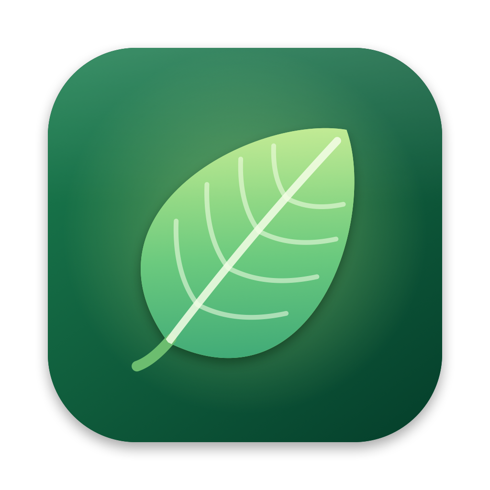

<p align="center">
  
</p>

<h1 align="center">CleanM</h1>

<p align="center">
  A native macOS cleaner and system monitor written in Swift + SwiftUI.<br>
  แอปทำความสะอาดและดูแลระบบ macOS แบบ native
</p>

<p align="center">
  <a href="https://github.com/Iambulldog/cleanM/releases/latest"></a>
  
  
</p>

## Features

| Module | What it does |
| --- | --- |
| **Smart Scan** | Scans System Junk, the Trash and Large & Old files in parallel, then cleans junk (to Trash) and empties the Trash. Large files are never removed automatically. |
| **System Junk** | User caches, user logs, Xcode DerivedData & Archives, Homebrew cache — per-item checkboxes, sizes and paths. |
| **Large & Old Files** | Files > 100 MB, or ≥ 5 MB and not opened for 6 months, in Downloads / Documents / Desktop / Movies. Filter by kind, size, age; Quick Look (Space) and Reveal in Finder. |
| **Uninstaller** | Apps in `/Applications` and `~/Applications` plus leftovers (Application Support, Preferences, Caches, Saved State, Containers, Group Containers, HTTPStorages, WebKit, Logs, Cookies). |
| **System Monitor** | CPU (per core), memory + pressure, disk, network — in the window and in the menu bar. *Free Up RAM* runs `/usr/sbin/purge` via the macOS admin prompt. |

## Install

### Option 1 — Download (no developer tools needed)

1. Download `CleanM-x.y.z.zip` from the [latest release](https://github.com/Iambulldog/cleanM/releases/latest).
2. Unzip it and drag **CleanM.app** into **Applications**.
3. CleanM is not notarized by Apple, so the first launch is blocked. Either:
   - open **System Settings → Privacy & Security**, scroll down and click **Open Anyway**, or
   - run once in Terminal:
     ```bash
     xattr -dr com.apple.quarantine /Applications/CleanM.app
     ```

### Option 2 — Build from source

Requires macOS 14+ and Xcode (or the Command Line Tools: `xcode-select --install`).

```bash
git clone https://github.com/Iambulldog/cleanM.git
cd cleanM
./scripts/install.sh      # builds and copies CleanM.app into /Applications
```

### วิธีติดตั้ง (ภาษาไทย)

- **ดาวน์โหลด:** โหลดไฟล์ `.zip` จากหน้า [Releases](https://github.com/Iambulldog/cleanM/releases/latest) แตกไฟล์ แล้วลาก CleanM.app ไปไว้ในโฟลเดอร์ Applications ครั้งแรกที่เปิด macOS จะบล็อกเพราะแอปไม่ได้ notarize ให้ไปที่ System Settings → Privacy & Security แล้วกด **Open Anyway** (หรือรันคำสั่ง `xattr` ด้านบน)
- **Build เอง:** `git clone` แล้วรัน `./scripts/install.sh`

## Updates

CleanM checks GitHub for a newer release once a day (turn this off in **Settings → Updates**) and shows an *Update available* badge in the sidebar. You can also use **CleanM → Check for Updates…** at any time.

To update a source install, pull and reinstall:

```bash
git pull && ./scripts/install.sh
```

## Full Disk Access

Without Full Disk Access macOS hides some caches, the Trash and app data from CleanM, so sizes are smaller than reality.

1. Open **System Settings → Privacy & Security → Full Disk Access** (or click *Open Settings* in the app's banner).
2. Click **+**, add **CleanM.app**, enable it, then relaunch CleanM.

The app is ad-hoc signed, so after installing a new version you may need to toggle Full Disk Access off and on again.

## Safety model

Every path is re-checked by `SafetyWhitelist` immediately before removal:

- Only paths inside your home folder are touched (plus top-level `.app` bundles in `/Applications` for the Uninstaller).
- Parent symlinks are resolved and `..` is rejected; symlinks themselves are removed, never followed.
- Top-level folders (`~/Library/Caches`, `~/Documents`, …) can't be deleted themselves.
- Important Apple data (CloudKit, Safari, iCloud, Keychains, …) is refused.
- Data of running apps, CleanM's own data, `/System` and `com.apple.*` apps are refused.
- The default action is **Move to Trash**; permanent deletion always asks for confirmation.

## Development

```bash
swift build                              # debug build
swift run                                # run without bundling
./scripts/build-app.sh                   # release build → build/CleanM.app
swift tools/make-icon.swift              # regenerate Resources/AppIcon.icns + AppIcon.png
```

### Versioning & releases

The version lives in [`VERSION`](VERSION) and follows [Semantic Versioning](https://semver.org/); the build number is the git commit count. To ship an update:

1. Bump `VERSION` (e.g. `1.0.0` → `1.1.0`) and add a section to [`CHANGELOG.md`](CHANGELOG.md).
2. Commit and push.
3. Run `PUBLISH=1 ./scripts/release.sh` — it builds a universal (Apple Silicon + Intel) app, zips it into `dist/`, tags `vX.Y.Z` and creates the GitHub release. Installed copies will then see the update.
